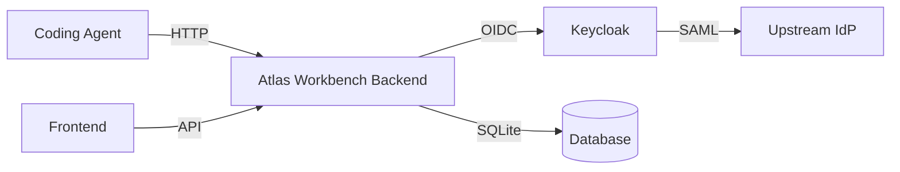

# Atlas Workbench — AI & Machine Learning

> Work in progress. This checkpoint may be incomplete or fail tests. See PLAN.md and STATUS.md before use.


A token compression proxy for AI coding agents. Sits between coding agents
(Claude Code, OpenCode, Codex) and LLM providers, compressing context while
preserving semantic fidelity via MCP-based recovery. Uses deterministic
"caveman-style" compression — shortening text to its essential meaning, like
a caveman communicating with fewer tokens while preserving intent.

## Problem

AI coding agents transmit large tool outputs (file contents, search results,
command output) to LLM providers on every turn. This wastes tokens when the
model context already contains the information or when a compact representation
suffices. The proxy intercepts requests, compresses eligible content
deterministically, and records recovery references (MCP) so downstream tools
can reconstruct the full context when needed.

## AI/ML Approach

The compression engine applies deterministic text-reduction rules:
- **Compress mode**: Removes redundant whitespace, trims verbose phrases,
  and applies keyword-preserving abbreviation while recording a recovery
  reference so the original is recoverable.
- **Summarize mode**: Produces a shorter summary of tool output.
- The engine is deterministic and works offline with no LLM API key.

**Intended user**: AI coding agent operators who want to reduce token
consumption without losing the ability to recover full context.

## AI/ML Evaluation

### Reproducible command (coming in `compression-engine` milestone)

The compression engine and its evaluation harness are planned for the next
round. The current milestone delivers the session management infrastructure:
creating, listing, filtering, updating, and ending compression sessions,
plus aggregated statistics.

### Baseline

| Metric | Baseline (no proxy) |
|--------|---------------------|
| Token count per request | Raw model context |
| Recovery mechanism | None |

### Measured Results

Not yet available — the compression engine is not yet implemented. The session
management API is tested end-to-end (24 backend tests, 5 frontend tests).

### Failure Cases

- Compression engine not yet implemented; sessions can be created and tracked
  but no actual token reduction is performed yet.
- OIDC login requires a running Keycloak instance; tests use mock JWT tokens.

## Features

- **OIDC authentication** via Keycloak with PKCE, state+nonce, and HttpOnly
  SameSite cookies with CSRF protection
- **Role-based access control** with operator/analyst/admin roles
- **Compression session management**: create, list, filter by mode, get,
  update, end, with pagination
- **Request tracking**: per-session request records with token counts,
  savings, duration, and MCP recovery status
- **Statistics dashboard**: aggregated token savings, eligibility rate,
  savings ratio per user
- **Audit logging**: login/logout and resource access tracking
- **Health checks**: liveness, readiness, and basic health endpoints
- **Multi-provider LLM config**: OpenAI-compatible, Anthropic, Gemini,
  Ollama (configured via environment variables)

## Architecture



## Install

### Prerequisites

- Python 3.12
- Node.js 24
- Docker and Docker Compose

### Local Development

Backend:
```bash
python3 -m venv .venv
.venv/bin/pip install -r backend/requirements.txt
PYTHONPATH=backend .venv/bin/python -m pytest backend/tests
.venv/bin/python -m uvicorn app.main:app --reload
```

Frontend:
```bash
cd frontend
npm install
npm test
npm run dev
```

### Docker Compose

```bash
cp .env.example .env
docker compose up --build
```

Services:
- Backend: http://localhost:8000
- Frontend: http://localhost:5173
- Keycloak: http://localhost:8080 (admin / admin-change-me)

## API Endpoints

| Method | Path | Auth | Description |
|--------|------|------|-------------|
| GET | /health | — | Basic health check |
| GET | /health/ready | — | Database readiness |
| GET | /health/live | — | Liveness probe |
| GET | /auth/login | — | OIDC login (redirect) |
| GET | /auth/callback | — | OIDC callback |
| POST | /auth/logout | ✓ | Logout |
| GET | /auth/me | — | User info |
| GET | /auth/csrf | ✓ | CSRF token |
| POST | /auth/verify-csrf | ✓ | Verify CSRF |
| POST | /compression/sessions | ✓ | Create session |
| GET | /compression/sessions | ✓ | List sessions |
| GET | /compression/sessions/{id} | ✓ | Get session |
| PATCH | /compression/sessions/{id} | ✓ | Update session |
| POST | /compression/sessions/{id}/end | ✓ | End session |
| GET | /compression/sessions/{id}/requests | ✓ | List requests |
| GET | /compression/stats/summary | ✓ | Stats summary |

## Provider Configuration

| Variable | Default | Description |
|----------|---------|-------------|
| LLM_PROVIDER | openai-compatible | Provider type |
| LLM_MODEL | — | Model identifier |
| LLM_BASE_URL | — | Custom API base URL |
| LLM_API_KEY | — | API key (server-side only) |
| OIDC_ISSUER_URL | http://localhost:8080/realms/atlas | Keycloak realm URL |
| OIDC_CLIENT_ID | atlas-workbench | OIDC client ID |
| OIDC_CLIENT_SECRET | — | OIDC client secret |

## Security

- OIDC authorization code flow with PKCE, state, and nonce
- JWT tokens are signed with HS256 and verified server-side
- Session cookies are HttpOnly, SameSite=Lax, and Secure in production
- CSRF protection on all write operations
- Demo mode is local-only (binds to 127.0.0.1) and refused in production
- No hardcoded credentials — all secrets via environment variables

## SSO / SAML Setup

Keycloak handles SAML identity brokering. Configure a SAML identity provider
in the Keycloak admin console, then map SAML attributes to user properties.
The application validates OIDC ID tokens only; SAML is handled by Keycloak.

---

Alan Vo | AI & Machine Learning | alanvo@gmail.com